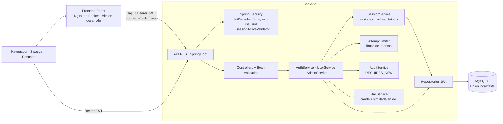
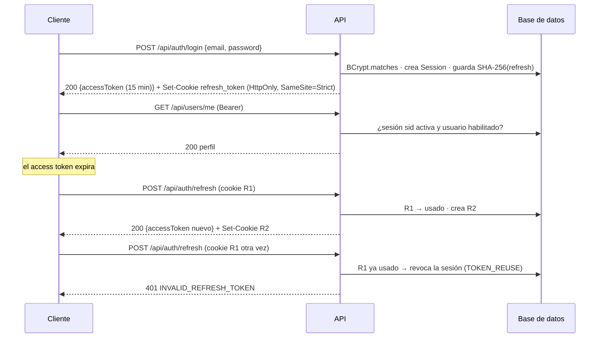
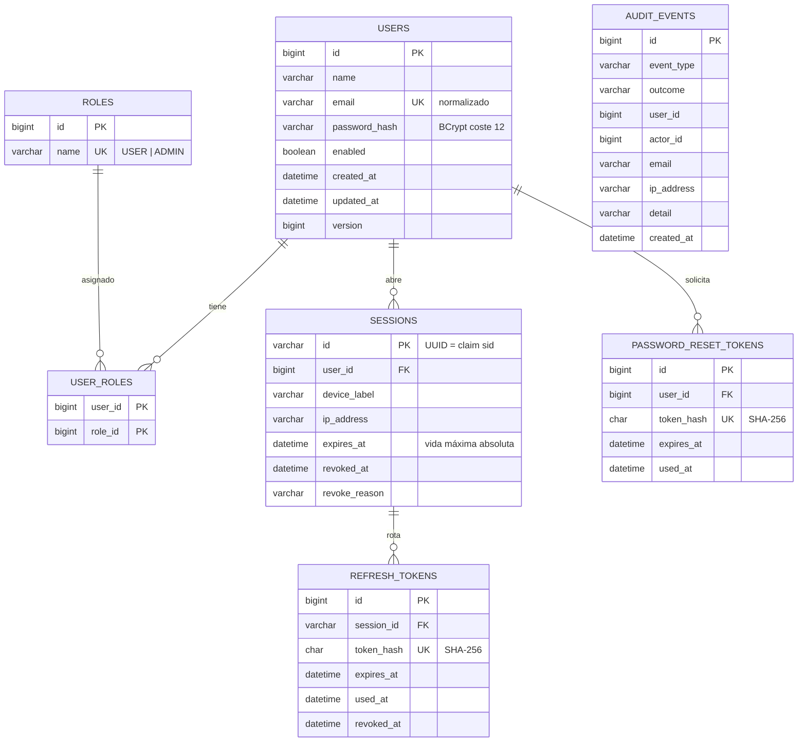

# Sistema de autenticación (Auth Service)

Servicio backend reutilizable de **identidad y acceso**: registro, inicio de sesión, emisión de tokens JWT,
renovación con refresh token rotatorio, cierre de sesión, roles `USER`/`ADMIN` y recuperación de contraseña.
Incluye un frontend opcional en React para demostrar los flujos y los permisos por rol.

> ⚠️ **Proyecto de portafolio educativo.** Todas las cuentas son **ficticias** (dominio `.demo`) y el envío de
> correos está **simulado** en desarrollo.

**Stack:** Java 17/21 · Spring Boot 3.3 · Spring Security (OAuth2 Resource Server + Nimbus JOSE) · Spring Data JPA ·
Bean Validation · Flyway · MySQL 8 / H2 · springdoc-openapi (Swagger) · JUnit 5 · React 18 + TypeScript + Vite ·
Docker Compose · GitHub Actions

---

## Funcionalidades

- **Registro** con nombre, email y contraseña. El email se normaliza (`trim` + minúsculas) y es único en base de datos.
  Política de contraseña: 8–72 caracteres con mayúscula, minúscula y número.
- **Login** que emite un **access token JWT de 15 minutos** (HS256) y un **refresh token** en cookie `HttpOnly`.
- **Refresh token rotatorio**: cada uso emite uno nuevo y el anterior deja de servir. Si un token ya rotado se
  reutiliza (señal de robo), **se revoca la sesión completa**.
- **Logout** que revoca la sesión: el refresh token y también el access token dejan de funcionar al instante.
- **Sesiones por dispositivo**: el usuario ve dónde tiene sesión abierta y puede cerrar cualquiera.
- **Roles y autorización** `USER` / `ADMIN` aplicados en el backend (filtro de seguridad + `@PreAuthorize`).
- **Administración**: listado paginado con búsqueda, asignar/quitar `ADMIN`, habilitar/deshabilitar cuentas, indicadores.
- **Recuperación de contraseña** con token aleatorio de **un solo uso** que vence en 30 minutos; envío simulado en
  una bandeja de desarrollo. Al restablecerla se cierran todas las sesiones.
- **Cambio de contraseña** desde el perfil (exige la actual y cierra las demás sesiones).
- **Límite de intentos**: 5 logins fallidos por email en 15 min → `429` con `Retry-After`; también por IP.
- **Sin enumeración de usuarios**: mismo `401` y mismo tiempo de respuesta si el email no existe, la contraseña es
  incorrecta o la cuenta está deshabilitada; la recuperación responde igual exista o no la cuenta.
- **Auditoría** de logins, bloqueos, recuperaciones y cambios sensibles, **sin contraseñas, hashes ni tokens**.
- **Swagger UI** y **colección Postman** con casos de éxito y error.

## Arquitectura



**Paquetes** (`com.portafolio.auth`): `config` · `controller` · `dto` · `entity` · `exception` · `mapper` ·
`repository` · `security` · `service` (+ `service.mail`) · `validation`.

### Flujo de tokens



## Modelo de datos (ERD)



El esquema lo crea **Flyway** (`backend/src/main/resources/db/migration/V1__schema.sql`); Hibernate solo lo valida.

## API

| Método | Ruta | Acceso | Responsabilidad |
|---|---|---|---|
| POST | `/api/auth/register` | público | Registrar cuenta (`201`, `409` si el email existe) |
| POST | `/api/auth/login` | público | Validar credenciales y emitir tokens (`401` genérico, `429` tras varios fallos) |
| POST | `/api/auth/refresh` | cookie | Rotar el refresh token y emitir un access token nuevo |
| POST | `/api/auth/logout` | cookie | Revocar la sesión (`204`, idempotente) |
| POST | `/api/auth/forgot-password` | público | Iniciar recuperación (`202`, misma respuesta siempre) |
| POST | `/api/auth/reset-password` | público | Cambiar contraseña con token válido (`400` si expiró o ya se usó) |
| GET | `/api/users/me` | USER | Perfil del usuario autenticado |
| PATCH | `/api/users/me` | USER | Actualizar nombre |
| POST | `/api/users/me/password` | USER | Cambiar contraseña (cierra otras sesiones) |
| GET | `/api/users/me/sessions` | USER | Sesiones activas |
| DELETE | `/api/users/me/sessions/{id}` | USER | Cerrar una sesión |
| GET | `/api/admin/users` | ADMIN | Listar usuarios (paginado, `q`, `enabled`) |
| GET | `/api/admin/users/{id}` | ADMIN | Ver un usuario |
| PUT | `/api/admin/users/{id}/roles` | ADMIN | Reemplazar roles (cierra sus sesiones) |
| PATCH | `/api/admin/users/{id}/status` | ADMIN | Habilitar / deshabilitar (cierra sus sesiones) |
| GET | `/api/admin/audit-events` | ADMIN | Auditoría paginada (`type`, `outcome`, `userId`) |
| GET | `/api/admin/stats` | ADMIN | Indicadores del panel |
| GET | `/api/dev/mailbox` | solo dev | Correos simulados (no existe con `DEV_OUTBOX_ENABLED=false`) |

Todos los errores usan el mismo formato:

```json
{
  "timestamp": "2026-11-23T22:58:01Z",
  "status": 400,
  "error": "Bad Request",
  "code": "VALIDATION_ERROR",
  "message": "La solicitud contiene datos inválidos",
  "path": "/api/auth/register",
  "fieldErrors": [{ "field": "password", "message": "La contraseña debe tener entre 8 y 72 caracteres, ..." }]
}
```

Swagger UI: `http://localhost:8080/swagger-ui.html` · Colección Postman: [`postman/auth-service.postman_collection.json`](postman/auth-service.postman_collection.json)

## Decisiones de seguridad

| Decisión | Por qué |
|---|---|
| **BCrypt coste 12** para contraseñas | Lento a propósito; nunca texto plano ni cifrado reversible. |
| **SHA-256** para refresh y reset tokens | Son 256 bits aleatorios: un hash rápido basta y permite buscarlos por índice. Si la base se filtra, no sirven. |
| **Access token en memoria**, refresh en cookie `HttpOnly; SameSite=Strict; Path=/api/auth` | Un XSS no puede leer el refresh token; un sitio externo no puede hacer que el navegador lo envíe (CSRF). |
| **Payload JWT mínimo** (`sub`, `roles`, `sid`, `iss`, `aud`, `exp`, `jti`) | El JWT está codificado, no cifrado: sin email ni datos personales. |
| **Validación completa del JWT**: firma HS256 (solo ese algoritmo), `exp`/`nbf`, `iss`, `aud` | Rechaza tokens expirados, alterados, mal firmados, de otro emisor o con `alg: none`. |
| **Sesión revisada en cada petición** (`sid`) | Logout, bloqueo de cuenta o cambio de roles surten efecto **al instante**, no al expirar el JWT. Coste: una consulta por clave primaria. |
| **Detección de reutilización** del refresh token, con 10 s de gracia | Un token rotado reutilizado indica robo → se revoca la sesión. La gracia evita falsos positivos por dos pestañas a la vez (el frontend además serializa con Web Locks). |
| **Vida máxima absoluta** de la sesión (7 días) | Las rotaciones no la extienden: no se confía indefinidamente en ningún token. |
| **BCrypt contra un hash ficticio** si el email no existe | El tiempo de respuesta no revela qué emails están registrados. |
| **Límite de intentos por email (exista o no) y por IP** | Frena fuerza bruta sin filtrar existencia de cuentas. |
| **Auditoría en `REQUIRES_NEW`** | Los intentos fallidos quedan registrados aunque la operación se revierta. |
| **Secretos por variables de entorno** | `JWT_SECRET` ≥ 32 bytes (la app no arranca si es más corto); `.env` está en `.gitignore`. |

## Cómo ejecutarlo

### Opción A: Docker Compose (MySQL + API + frontend)

Requisitos: Docker Desktop.

```bash
cp .env.example .env        # y cambia DB_PASSWORD, DB_ROOT_PASSWORD y JWT_SECRET
docker compose up --build
```

- Frontend: <http://localhost:3000>
- Swagger: <http://localhost:8080/swagger-ui.html>

### Opción B: local sin Docker (H2 en memoria)

Requisitos: Java 17 o 21 y Node 22. No necesita base de datos: el perfil `local` usa H2 en modo MySQL.

```bash
# Terminal 1 — API en http://localhost:8080
cd backend
./mvnw spring-boot:run          # Windows: mvnw.cmd spring-boot:run

# Terminal 2 — frontend en http://localhost:5175 (redirige /api al 8080)
cd frontend
npm install
npm run dev
```

### Cuentas de demostración

Contraseña de todas: `Demo1234!` (configurable con `DEMO_PASSWORD`).

| Email | Rol | Estado |
|---|---|---|
| `admin@auth.demo` | USER + ADMIN | habilitada |
| `ana@auth.demo` | USER | habilitada |
| `luis@auth.demo` | USER | habilitada |
| `sofia@auth.demo` | USER | habilitada |
| `carla@auth.demo` | USER | deshabilitada (para probar el login rechazado) |

### Recorrido sugerido

1. Entra con `ana@auth.demo` → **Perfil**. Abre `/admin`: verás un 403 (y el backend también lo rechaza).
2. **Seguridad y sesiones**: inspecciona el JWT decodificado, pulsa *Renovar ahora* y observa la rotación.
3. Abre otra ventana privada, entra con la misma cuenta y cierra esa sesión desde la primera.
4. Sal y usa **¿Olvidaste tu contraseña?** → abre el enlace desde la **bandeja simulada** → cambia la contraseña.
5. Entra con `admin@auth.demo` → **Usuarios y roles**: deshabilita a Ana y comprueba que su sesión cae al instante.
   Revisa todo en **Auditoría**.

## Pruebas

```bash
cd backend
./mvnw test
```

41 pruebas (integración con MockMvc + H2 y unitarias). Cubren todos los criterios de aceptación de la guía:

| Criterio | Prueba |
|---|---|
| Registro correcto y rechazo de email duplicado | `Register.*` |
| Login válido e inválido sin filtrar si falló email o contraseña | `Login.loginInvalidoNoRevelaSiFalloElEmailOLaContrasena` |
| Endpoint privado rechaza sin token y acepta token válido | `Protected.rechazaPeticionSinTokenYAceptaTokenValido` |
| USER no accede a endpoint ADMIN | `Protected.usuarioUserNoPuedeAccederAEndpointAdmin` |
| Token expirado, alterado o mal firmado rechazado (también emisor/audiencia/`alg:none`) | `Protected.tokenExpiradoAlteradoOMalFirmadoEsRechazado` |
| Refresh token se rota y el anterior deja de servir | `RefreshAndLogout.refreshTokenSeRotaYElAnteriorDejaDeServir` |
| Reutilización de refresh token revoca la sesión | `RefreshAndLogout.reutilizarUnRefreshTokenRotadoRevocaLaSesionCompleta` |
| Logout revoca la sesión | `RefreshAndLogout.logoutRevocaLaSesion` |
| Token de recuperación expira y no se reutiliza | `PasswordReset.*` |
| Logs y respuestas nunca contienen `passwordHash` ni tokens | `logsYRespuestasNoContienenSecretos` (captura la salida de logs) |
| Límite de intentos sin enumeración | `Login.bloqueaTrasVariosIntentosFallidosExistaONoLaCuenta` |

El pipeline [`.github/workflows/ci.yml`](.github/workflows/ci.yml) ejecuta las pruebas con Java 21 y compila el frontend.

## Variables de entorno

| Variable | Por defecto | Descripción |
|---|---|---|
| `JWT_SECRET` | *(solo dev)* | Clave HS256, mínimo 32 bytes. **Obligatoria en producción.** |
| `JWT_ACCESS_MINUTES` | `15` | Vida del access token |
| `REFRESH_TTL_DAYS` | `7` | Vida máxima de la sesión / refresh token |
| `REFRESH_COOKIE_SECURE` | `false` | `true` detrás de HTTPS |
| `PASSWORD_RESET_TTL_MINUTES` | `30` | Vigencia del enlace de recuperación |
| `FRONTEND_URL` | `http://localhost:5175` | Base del enlace del correo |
| `MAX_LOGIN_FAILURES` / `LOGIN_WINDOW_MINUTES` | `5` / `15` | Límite de intentos |
| `DEV_OUTBOX_ENABLED` | `true` local, `false` prod | Bandeja de correo simulada |
| `SEED_DEMO_DATA` / `DEMO_PASSWORD` | `true` / `Demo1234!` | Cuentas ficticias |
| `CORS_ALLOWED_ORIGINS` | `http://localhost:5175` | Orígenes permitidos |
| `DB_URL` / `DB_USERNAME` / `DB_PASSWORD` | — | MySQL (perfil `prod`) |

## Limitaciones y mejoras posibles

Descripción honesta del alcance de la demo:

- **Correo simulado**: no hay proveedor SMTP. `MailService` es el punto de extensión.
- **Límite de intentos en memoria**: correcto para una instancia; con varias réplicas iría a Redis.
- **Clave simétrica HS256**: suficiente porque el mismo servicio emite y valida. Si otros servicios validaran los
  tokens, convendría RS256/EdDSA con JWKS para no compartir el secreto.
- **Docker Compose sin probar en este equipo** (no tenía Docker); las pruebas automatizadas corren sobre H2 en modo
  MySQL. Mejora: Testcontainers con MySQL real.
- **Verificación de email** (opcional en la guía) y **2FA/TOTP** no implementados.
- La recuperación hace un poco más de trabajo cuando la cuenta existe (inserta el token); un envío asíncrono
  igualaría también ese tiempo.
